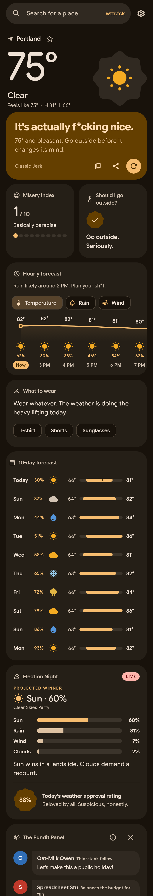
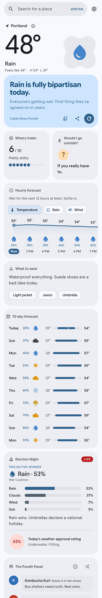
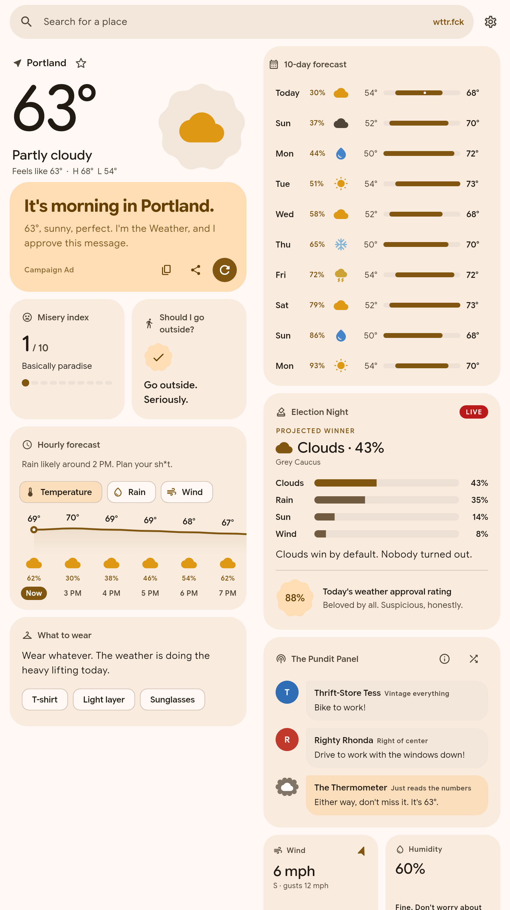
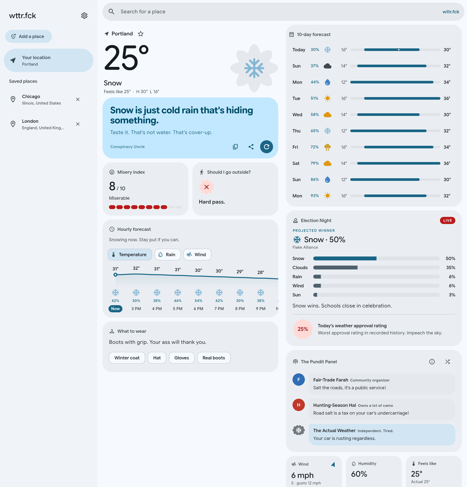

<p align="center">
  
</p>

<h1 align="center">wttr.fck</h1>
<p align="center"><b>The weather, with attitude.</b><br>
A free, open-source weather app that tells you the real forecast and swears at you about it.</p>

<p align="center">
  <a href="https://kashcotton.github.io/wttr.fck/"><b>Open the web app</b></a> ·
  <a href="https://github.com/kashcotton/wttr.fck/releases/latest">Download for Android, Windows, Linux</a> ·
  <a href="CONTRIBUTING.md">Add your own roasts</a>
</p>

<p align="center">
  
  
  
</p>

## What it does

- **A real forecast.** Current conditions, 48 hours of temperature, rain and wind, a "rain starting in 30 minutes" heads-up, 10 days you can tap into hour by hour, air quality, UV, wind, humidity and dew point, cloud cover, pressure, visibility, sunrise and sunset, for anywhere on Earth.
- **Official weather warnings.** From the US National Weather Service, Environment Canada, Germany's DWD and MeteoAlarm (most of Europe, in the apps). Everywhere else it flags dangerous heat, cold, wind, rain and storms from the forecast, clearly marked as unofficial.
- **Roasts you about it.** Every kind of weather has its own lines, in six voices: Classic Jerk, Cable News Pundit, Disappointed Parent, Middle Manager, Campaign Ad, Conspiracy Uncle.
- **For everyone.** Pick **Clean** (fudge, heck), **Salty** (f\*ck) or **Unhinged**. Same jokes, different filth.
- **Politics, optional and fair.** The *Pundit Panel* has a rotating cast of 50 made-up pundits argue about the weather, with a fresh take every time. *Election Night* has Sun, Rain, Clouds, Wind and Snow run for office with vote shares taken from the real forecast. Both sides get roasted equally, no real people are named, and one switch turns all of it off.
- **Actually useful.** Misery index, a "should I go outside?" verdict, what to wear.
- **Written by the community.** Every line lives in plain JSON in [`content/`](content/). Merged roasts reach every user automatically, with credit.
- **Free.** No ads, no account, no tracking, no API keys.

## Design

Built on Google's **Material 3 Expressive**: Google Sans Flex, tonal color that
matches your Android wallpaper (Material You) or re-tints to match the sky, or
any color you pick in Settings, expressive shapes that morph with the weather
(a sunny burst, a cookie for clouds, a flower for snow), and spring motion.

It adapts to every screen using Material's window size classes:

| Screen | Layout |
|---|---|
| Phone | Single column |
| Tablet / small window | Wider single column |
| Unfolded foldable | Two panes, split exactly at the hinge |
| Half-folded (tabletop) | Weather on the top half, details below the fold |
| Desktop / large | Saved places pane + two content panes |

<p align="center">
  
</p>

## Platforms

| Platform | How |
|---|---|
| Web | [kashcotton.github.io/wttr.fck](https://kashcotton.github.io/wttr.fck/). Installable as an app from the browser |
| Android | APK from [Releases](https://github.com/kashcotton/wttr.fck/releases/latest) |
| Windows | Zip from Releases, run `wttr_fck.exe` |
| Linux | tar.gz from Releases, run `./wttr_fck` |

## Build it yourself

Needs [Flutter](https://flutter.dev) 3.50+.

```sh
flutter pub get
flutter run                       # whatever device you have
flutter test --exclude-tags screenshots
flutter build web --release
flutter build apk --release
flutter build linux --release     # needs clang, cmake, ninja, gtk3 dev headers
flutter build windows --release   # on Windows with Visual Studio C++
```

## How releases work

Everything is built by GitHub Actions:

- **Every push / PR:** analyze, run tests, validate community roasts ([`ci.yml`](.github/workflows/ci.yml))
- **Every push to `main`:** rebuild and publish the website ([`pages.yml`](.github/workflows/pages.yml))
- **Push a tag like `v1.1.0`:** build Android, Windows, Linux and web, then publish a release ([`release.yml`](.github/workflows/release.yml))

To sign Android builds with your own key, add these repository secrets:
`ANDROID_KEYSTORE_BASE64`, `ANDROID_KEYSTORE_PASSWORD`, `ANDROID_KEY_ALIAS`, `ANDROID_KEY_PASSWORD`.
Without them, builds are signed with a debug key, which is fine for sideloading but not for the Play Store.

## Credits

- Weather data: [Open-Meteo.com](https://open-meteo.com), CC BY 4.0
- Place names: Open-Meteo Geocoding, BigDataCloud. Approximate location: GeoJS
- Font: Google Sans Flex, SIL Open Font License 1.1
- Roasts: [everyone who contributed](https://github.com/kashcotton/wttr.fck/graphs/contributors)

Code and content are MIT licensed. See [LICENSE](LICENSE).
